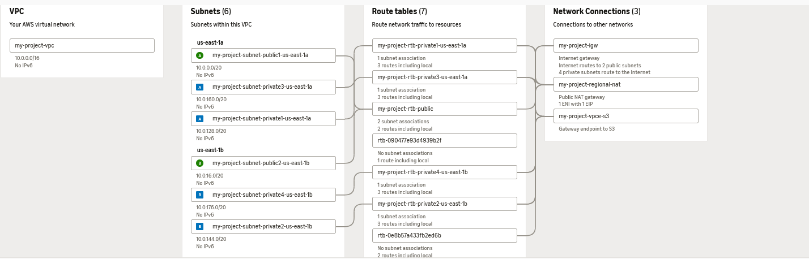
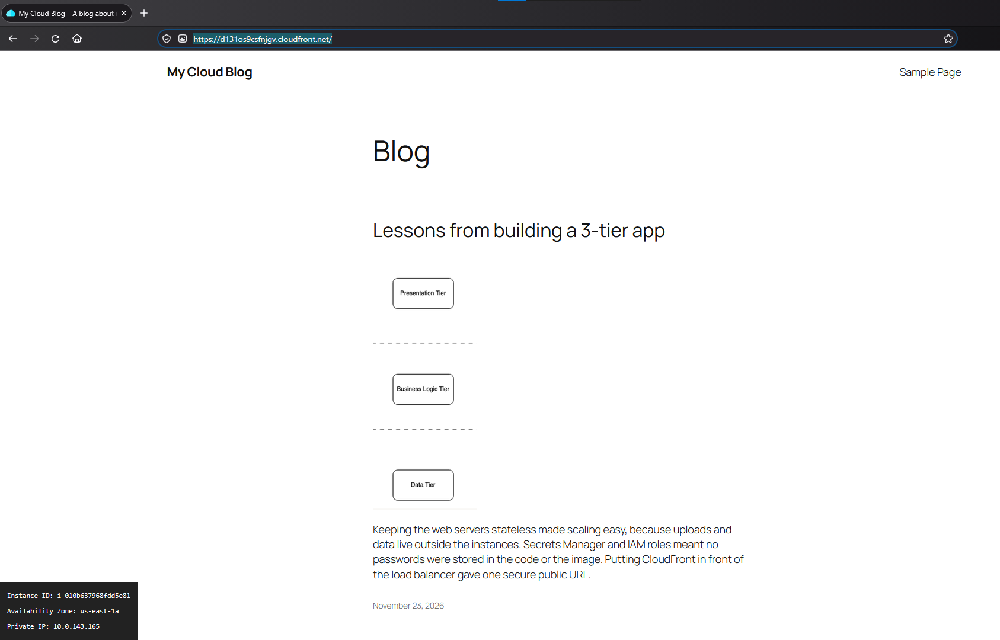
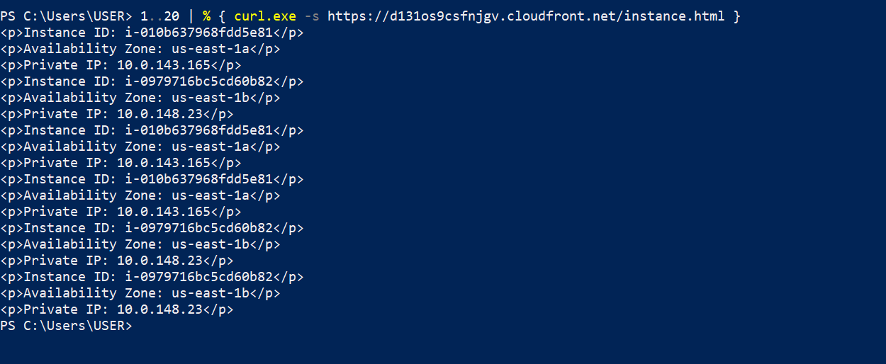
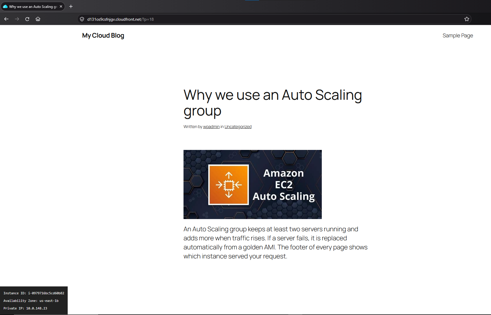

# 3-Tier WordPress on AWS

Resilient, scalable, secure WordPress deployment: CloudFront → ALB → Auto Scaling group (EC2) → RDS MySQL + EFS.

**Live URL:** https://d131os9csfnjgv.cloudfront.net  (available until , then torn down)

**Diagram:**  https://lucid.app/lucidchart/2f540b19-38ab-413d-a843-dabe2e19b9c0/edit?viewport_loc=-471%2C-215%2C3475%2C1654%2Cp1&invitationId=inv_03464063-26e9-4bea-883e-f9ba810684d9)

## Architecture
User → CloudFront → ALB → Target group → EC2 (private subnets, 2 AZs, Auto Scaling)
Data: RDS MySQL (private) and EFS (media uploads). Secrets in AWS Secrets Manager via an IAM role.

## Requirements met
- Internet access, media upload/retrieval, data persisted in RDS
- Two-AZ app tier, auto scaling (min 2, max 4, CPU 50%)
- No hardcoded credentials (Secrets Manager + IAM role)
- CloudWatch alarms, SNS, CloudTrail, RDS logs

## Documentation
- [Part 1 – Design (Well-Architected)](docs/Part1-Design.pdf)
- [Part 2 – Implementation documentation](docs/Part2-Documentation.pdf)

## Known limitation
RDS is single-AZ because of Free plan restrictions. Multi-AZ is a one-setting change. See the documentation, section 6.

## Screenshots

## Setup summary
1. VPC, subnets, gateways, security groups
2. RDS, EFS, IAM role
3. Build instance, WordPress, boot script (`scripts/`)
4. Golden AMI, launch template
5. ALB, target group, Auto Scaling group
6. CloudFront, monitoring, tests

Scripts have placeholders instead of real IDs and secrets.
